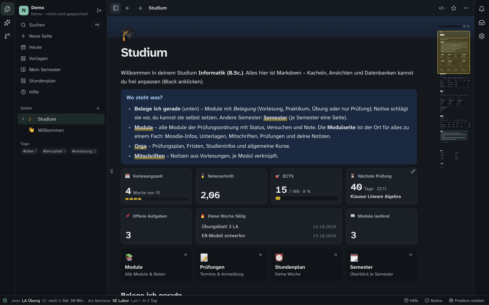
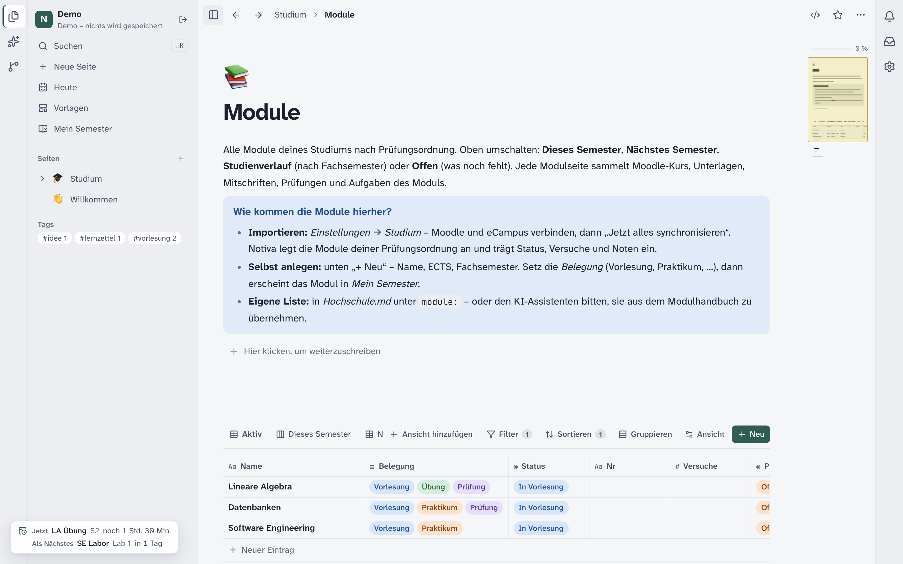
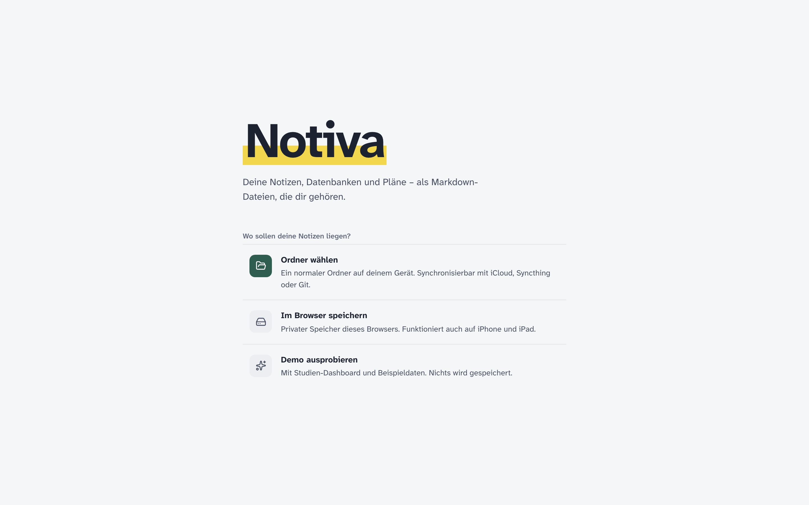

# Notiva 📝 – Notizen, Datenbanken und Studium als Markdown-Dateien

<p align="center">
  
</p>

<p align="center">
  <b>Wie Notion – nur lokal, frei und in Dateien, die dir gehören.</b><br>
  Seiten, Datenbanken, Dashboards und ein komplettes Studium mit Moodle, eCampus und Prüfungsplan.<br>
  Ohne Konto, ohne Cloud, ohne Tracking. Als Desktop-App und als Web-App fürs Handy.
</p>

<p align="center">
  <a href="LICENSE"></a>
  
  
</p>

<p align="center"><b>Deutsch</b> · <a href="README.en.md">English</a></p>

---

## Inhalt

- [Worum geht es?](#worum-geht-es)
- [Was Notiva kann](#was-notiva-kann)
- [Praktika mit Editor und Terminal](#praktika-mit-editor-und-terminal)
- [Kurz erklärt: die wichtigsten Begriffe](#kurz-erklärt-die-wichtigsten-begriffe)
- [Installieren und starten](#installieren-und-starten)
- [Studium einrichten in 5 Schritten](#studium-einrichten-in-5-schritten)
- [Andere Hochschule?](#andere-hochschule)
- [Ohne eigene Daten ausprobieren](#ohne-eigene-daten-ausprobieren)
- [Wie die Dateien aussehen](#wie-die-dateien-aussehen)
- [Deine Daten](#deine-daten)
- [Häufige Fragen](#häufige-fragen)
- [Für Entwickler](#für-entwickler)

---

## Worum geht es?

Notion ist praktisch, aber deine Notizen liegen auf fremden Servern, und ohne Internet geht wenig. Notiva macht
dasselbe mit **normalen Markdown-Dateien in einem Ordner auf deinem Gerät**. Du kannst den Ordner mit iCloud,
Syncthing oder Git synchronisieren, mit jedem Texteditor öffnen und jederzeit mitnehmen.

Dazu kommt ein **Studien-Modus**: Notiva holt Kurse, Unterlagen und Termine aus Moodle, Noten und Prüfungen aus
dem eCampus (HISinOne) und den Prüfungsplan der Fakultät. Daraus entstehen Modulseiten, ein Stundenplan und
„Mein Semester“. Voreingestellt ist die Hochschule Düsseldorf; andere Hochschulen trägst du in einer einzigen Seite
ein ([docs/HOCHSCHULE.md](docs/HOCHSCHULE.md)).

## Was Notiva kann

<table>
  <tr>
    <td width="33%" align="center"></td>
    <td width="33%" align="center"></td>
    <td width="33%" align="center"></td>
  </tr>
  <tr>
    <td valign="top"><b>Datenbanken</b><br>Tabelle, Board, Kacheln, Liste und Kalender. Eigenschaften, Formeln, Relationen, Filter, Gruppen – jede Zeile ist eine Markdown-Datei.</td>
    <td valign="top"><b>Mein Semester</b><br>Alle Module, die du gerade belegst: Vorlesungen, neue Dateien, bearbeitete PDFs, Mitschriften und Code.</td>
    <td valign="top"><b>Vorlagen</b><br>Studien-Dashboard, Vorlesungsnotiz, Lernzettel, Projekte und mehr. Eigene Vorlagen sind normale Seiten.</td>
  </tr>
  <tr>
    <td width="33%" align="center"></td>
    <td width="33%" align="center"></td>
    <td width="33%" align="center"></td>
  </tr>
  <tr>
    <td valign="top"><b>Einstellungen</b><br>Moodle, eCampus, Benachrichtigungen, KI, Speicher, Farben, Schrift, Sprache (Deutsch/Englisch).</td>
    <td valign="top"><b>Hell & Dunkel</b><br>Folgt dem System oder fest einstellbar – hier hell, oben dunkel.</td>
    <td valign="top"><b>Dein Speicherort</b><br>Ordner auf dem Gerät, privater Browser-Speicher (auch iPhone/iPad) oder eine Demo.</td>
  </tr>
</table>

**Außerdem:**

- 📝 **Block-Editor** wie Notion, aber jeder Block ist echtes Markdown: `/`-Befehle, `[[Links]]`, Aufgaben, Callouts,
  Formeln, Code mit Kopier-Knopf.
- 🧩 **Dashboards** mit Kacheln: Kennzahlen, Fortschritt, Countdown, Listen, eingebettete Ansichten.
- 🎓 **Studium**: Module mit Status, Versuchen und Note, gewichteter Notenschnitt, ECTS, Prüfungen, Stundenplan,
  Anzeige „Jetzt / Als Nächstes“.
- 📄 **PDF-Ansicht** mit Suche, stufenlosem Zoom, Markierungen, Kommentaren und Seitennotizen.
- 🎙️ **Vorlesungsmodus**: nimmt auf, schreibt lokal mit Whisper mit und folgt den Folien.
- 💻 **Code-Ordner** pro Seite mit Editor, Terminal und Git.
- 🤖 **KI, wenn du willst**: Assistent mit sichtbarem Kontext (Claude Code, Codex, Ollama, eigene Schlüssel) und ein
  MCP-Server für Claude Desktop & Co. – mit abgesicherten Werkzeugen.
- 🌿 **Git eingebaut**: Änderungen, Diff, Commit, Verlauf, Push/Pull.
- 🔔 **Benachrichtigungen** für neue Unterlagen, Fristen, Noten und Ausfälle.

## Praktika mit Editor und Terminal

<p align="center">
  
</p>

Praktikumsaufgaben bearbeitest du direkt neben deinen Notizen – ohne zwischen Editor, Terminal, Moodle und PDF zu
wechseln:

- **Ein Klick:** In _Mein Semester_ hat jedes Modul mit Praktikum oder Übung den Knopf **„Praktikum bearbeiten“**.
  Notiva legt einen Code-Ordner zum Modul an (mit `.gitignore`) und öffnet ihn.
- **Editor und Terminal:** Dateien (Python, Java, SQL, JS, HTML, …) mit Syntaxhervorhebung bearbeiten, darunter ein
  echtes Terminal im Ordner – auch zwei nebeneinander. Verläufe bleiben erhalten.
- **Aufgabe daneben:** das Aufgabenblatt als PDF mit Terminal darunter, Moodle-Seiten und Links des Kurses als
  Webseite neben dem Terminal.
- **Git eingebaut:** Änderungen ansehen, committen, pushen – mit Fortschrittsanzeige.
- **KI dazu:** Der Assistent sieht auf Wunsch die offene Datei oder PDF-Seite (Claude Code, Codex, Ollama, …).

Terminal und Editor gibt es in der Desktop-App.

## Kurz erklärt: die wichtigsten Begriffe

| Begriff         | Bedeutung                                                                                                  |
| --------------- | ---------------------------------------------------------------------------------------------------------- |
| **Ordner**      | Der Ordner mit deinen Notizen (in anderen Apps „Vault“). Alles in Notiva ist eine Datei darin.             |
| **Seite**       | Eine Markdown-Datei. Unterseiten liegen in einem gleichnamigen Ordner daneben.                             |
| **Eigenschaft** | Ein Feld im Kopf einer Seite (Frontmatter), z. B. `Status`, `ECTS` oder `Note`.                            |
| **Datenbank**   | Eine Seite, deren Unterseiten dieselben Eigenschaften haben. Ansichten zeigen sie als Tabelle, Board usw.  |
| **Kachel**      | Ein Baustein im Dashboard: Zahl, Fortschritt, Liste oder eine eingebettete Ansicht.                        |
| **Modul**       | Ein Fach aus der Prüfungsordnung. Seine Seite sammelt Moodle-Kurs, Unterlagen, Mitschriften und Prüfungen. |
| **Belegung**    | Was du in einem Modul gerade belegst: Vorlesung, Praktikum, Übung oder nur die Prüfung.                    |
| **Profil**      | `Studium/Hochschule.md` – Adressen und Studiengang deiner Hochschule.                                      |

## Installieren und starten

**Herunterladen:** die neueste Version unter [Releases](https://github.com/flexi03/notiva/releases/latest) –
macOS (Apple Silicon, `.dmg`), Windows (`.exe`) oder Linux (`.AppImage`). Die App ist nicht signiert: auf dem Mac beim
ersten Öffnen Rechtsklick → Öffnen, unter Windows „Weitere Informationen → Trotzdem ausführen“.

**Updates:** Notiva sieht beim Start und jede Stunde nach neuen Versionen, meldet sie und installiert sie mit einem
Klick („Jetzt aktualisieren“); von Hand über _Notiva → Nach Updates suchen …_. Was neu ist: [CHANGELOG.md](CHANGELOG.md).

**Aus dem Quelltext** (Voraussetzung: [Node.js](https://nodejs.org) 24 oder neuer):

```bash
git clone https://github.com/flexi03/notiva.git
cd notiva
npm install
npm run electron     # Desktop-App
npm run dev          # oder: Web-App unter http://localhost:5173
```

Eigene Installationspakete: `npm run dist:mac`, `npm run dist:win` oder `npm run dist:linux` (Ausgabe in `release/`).
Die Pakete sind nicht signiert; macOS fragt beim ersten Öffnen nach (Rechtsklick → Öffnen).

Als Web-App aufs Handy: Seite im Browser öffnen → „Zum Home-Bildschirm“.

## Studium einrichten in 5 Schritten

1. **Ordner wählen.** Beim ersten Start „Ordner wählen“ und einen leeren Ordner anlegen, z. B. `Studium`.
2. **Studium anlegen.** Unten links „Studium einrichten → Einrichten“ → „Studium anlegen“ (oder _Einstellungen → Studium_).
   Studiengang und erstes Semester wählen – oder **„Eigener Studiengang / andere Hochschule“** mit Name und ECTS-Ziel.
   Notiva legt Dashboard, Semester, Prüfungen, Aufgaben und Stundenplan an.
3. **Hochschule prüfen.** `Studium/Hochschule.md` öffnen. Für die HSD passt alles; für eine andere Hochschule die
   Adressen eintragen ([Anleitung](docs/HOCHSCHULE.md), Vorlage in [examples/](examples/)) – oder den KI-Assistenten
   bitten.
4. **Moodle und eCampus verbinden** (Desktop-App). _Einstellungen → Studium_. Die Anmeldung läuft im Fenster deiner
   Hochschule; Notiva speichert kein Passwort.
5. **Synchronisieren.** In der Werkzeugleiste auf das Sync-Symbol → „Jetzt alles synchronisieren“. Jetzt kommen die
   **Module** dazu – mit Status, Versuchen und Noten. Danach prüft Notiva im Hintergrund selbst und meldet Neues.

**Ohne Moodle oder eCampus?** Dann bleibt _Module_ zunächst leer – leg deine Fächer dort mit „+ Neu“ an (Name, ECTS,
Fachsemester, _Belegung_) oder trag sie als Liste in `Hochschule.md` ein. Die Seite _Module_ erklärt beide Wege.

Ausführlich, mit KI, Git, Tastenkürzeln und MCP: [docs/ANLEITUNG.md](docs/ANLEITUNG.md).

## Andere Hochschule?

Notiva ist auf die Hochschule Düsseldorf voreingestellt, funktioniert aber auch anderswo:

- **Moodle** läuft mit jeder Moodle-Adresse (_Einstellungen → Studium → Moodle_).
- **Noten und Prüfungen** kommen aus HISinOne/QIS-Portalen; die Adressen stehen in `Studium/Hochschule.md`.
- **Der KI-Assistent** kann die Seite für dich ausfüllen: „Stelle Notiva auf die Uni X ein, unser Moodle ist …“.
- **Klappt etwas nicht?** [Issue auf GitHub öffnen](https://github.com/flexi03/notiva/issues/new?template=hochschule.md)
  (Vorlage „Hochschule“) – dann wird deine Hochschule fest eingebaut. Bitte keine Passwörter oder Noten posten.

## Ohne eigene Daten ausprobieren

Auf dem Startbildschirm **„Demo ausprobieren“**. Die Demo hat ein fertiges Studien-Dashboard mit Beispielmodulen,
Prüfungen und Stundenplan. Nichts davon wird gespeichert.

## Wie die Dateien aussehen

```
Studium.md                      ← Dashboard (Kacheln als YAML-Block im Markdown)
Studium/Hochschule.md           ← Profil deiner Hochschule
Studium/Module.md               ← Datenbank: Schema und Ansichten im Kopf
Studium/Module/Analysis I.md    ← ein Eintrag
```

```markdown
---
Status: Bestanden
ECTS: 9
Note: 2.3
Semester: ['[[1. Semester]]']
---

## Inhalte

- Folgen und Reihen
```

Alle Details: [docs/FORMAT.md](docs/FORMAT.md). Ein kleiner Beispielordner liegt in [examples/vault](examples/vault).

## Deine Daten

- **Alles bleibt auf deinem Gerät.** Kein Konto, keine Cloud, keine Telemetrie.
- **Logins** für Moodle und eCampus laufen über die Seiten deiner Hochschule. Notiva hält nur die Sitzung, wie ein
  Browser.
- **KI** ist aus, bis du sie einschaltest. Was gesendet wird, zeigt die Kontext-Leiste vor dem Senden.
- **App-Daten** (Sitzungen, Benachrichtigungen, Terminal-Verläufe) liegen im Profilordner der App, nicht in deinem
  Notizen-Ordner und nicht in diesem Repository.

Mehr dazu: [docs/SECURITY.md](docs/SECURITY.md).

## Häufige Fragen

**Kann ich meine Notion-Seiten übernehmen?**
Seiten ja: in Notion als Markdown exportieren und den Ordner in Notiva öffnen. Notion-Datenbanken kommen dabei als
CSV; die übernimmt Notiva noch nicht automatisch.

**Funktioniert das an meiner Hochschule?**
Moodle läuft überall. eCampus-Noten setzen HISinOne voraus. Adressen, Prüfungsplan und Studiengang stellst du in
`Studium/Hochschule.md` ein ([docs/HOCHSCHULE.md](docs/HOCHSCHULE.md)) – siehe [Andere Hochschule?](#andere-hochschule).

**Warum zeigt macOS keine Mitteilungen?**
Die App ist nicht signiert. Notiva nutzt dann eine kleine Hilfs-App „Notiva“. Erlauben unter
_Systemeinstellungen → Mitteilungen_; der Test-Knopf in _Einstellungen → Benachrichtigungen_ zeigt das Ergebnis.

**Brauche ich die KI?**
Nein. Alles funktioniert ohne. Lokal und kostenlos geht es mit Ollama oder LM Studio.

## Für Entwickler

```bash
npm run check        # Typen, Lint, Unit-Tests
npm run test:e2e     # Playwright: Desktop, Tablet, iPhone (WebKit) und Electron
npm run build && node scripts/screenshots.mjs   # Bilder für dieses README
```

Aufbau und Regeln: [AGENT.md](AGENT.md) · [docs/ARCHITECTURE.md](docs/ARCHITECTURE.md) ·
[docs/DESIGN.md](docs/DESIGN.md) · [docs/SECURITY.md](docs/SECURITY.md) · Fortschritt: [PROGRESS.md](PROGRESS.md)

## Lizenz

[MIT](LICENSE) © flexi03 – frei nutzbar, veränderbar und weitergebbar.
