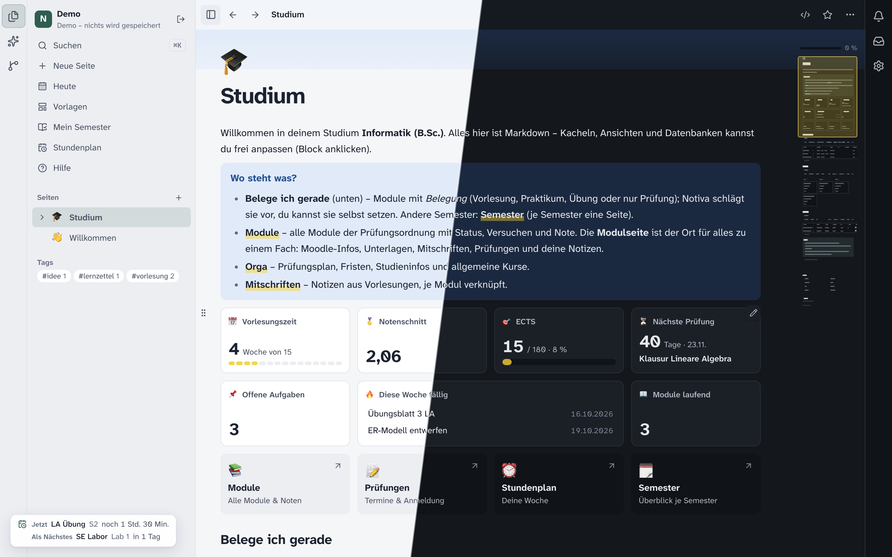
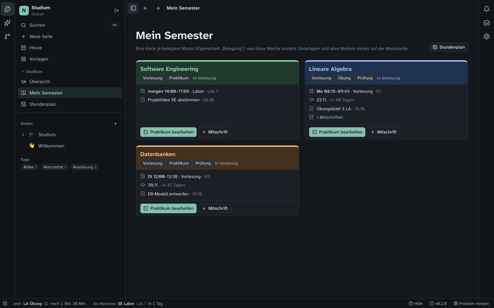
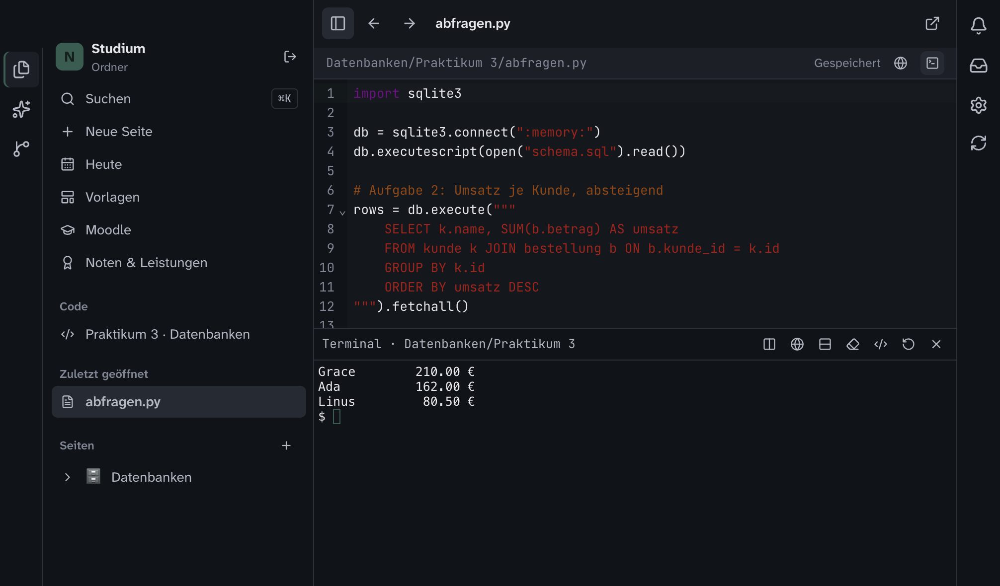
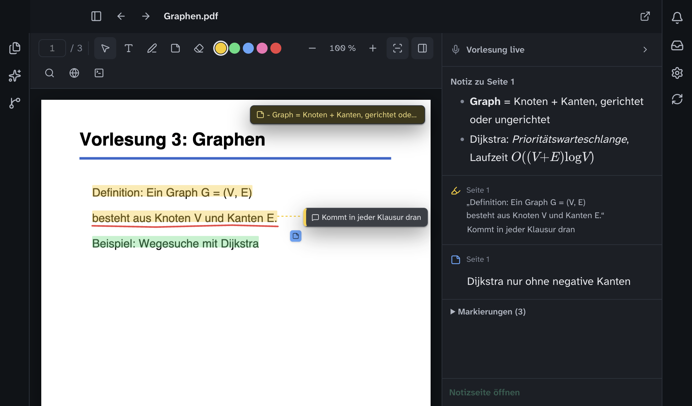
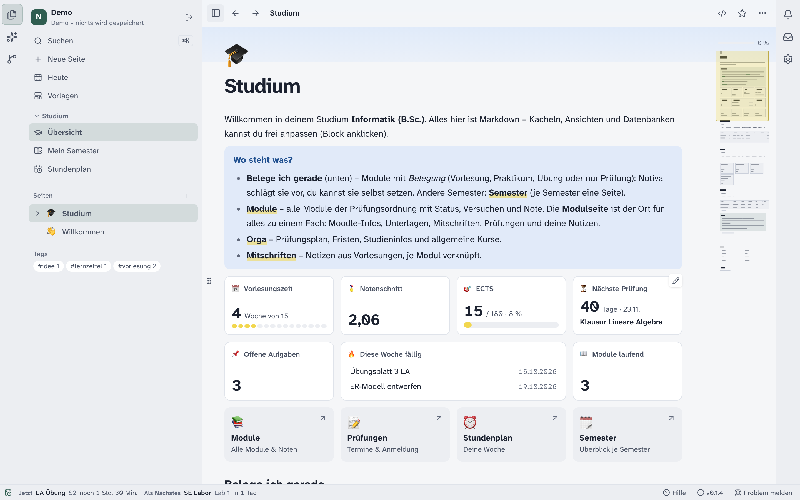
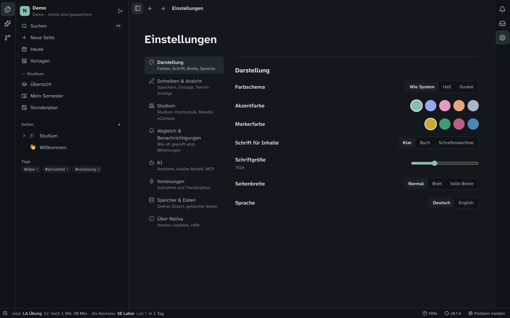
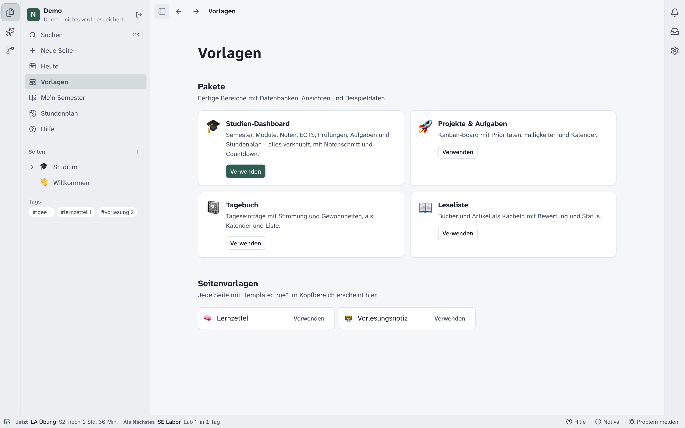

# Notiva 📝 – dein Studium und deine Notizen in Markdown

<p align="center">
  
</p>

<p align="center">
  <b>Notizen, Studium, Code und PDF-Anmerkungen an einem Ort – als Markdown-Dateien, die dir gehören.</b><br>
  Ein Hub für dein Studium: Moodle, eCampus und Prüfungsplan angebunden, KI-Assistent auf Wunsch.<br>
  Für die Hochschule Düsseldorf eingerichtet, für andere Hochschulen anpassbar. Für Laptop und PC.
</p>

<p align="center">
  <a href="LICENSE"></a>
  
  
</p>

<p align="center"><b>Deutsch</b> · <a href="README.en.md">English</a></p>

---

## Inhalt

- [Worum geht es?](#worum-geht-es)
- [Was Notiva kann](#was-notiva-kann)
- [Praktika mit Editor und Terminal](#praktika-mit-editor-und-terminal)
- [Skripte lesen und anmerken](#skripte-lesen-und-anmerken)
- [Hub mit Schnittstellen und KI](#hub-mit-schnittstellen-und-ki)
- [Kurz erklärt: die wichtigsten Begriffe](#kurz-erklärt-die-wichtigsten-begriffe)
- [Installieren und starten](#installieren-und-starten)
- [Studium einrichten in 5 Schritten](#studium-einrichten-in-5-schritten)
- [Andere Hochschule?](#andere-hochschule)
- [Ohne eigene Daten ausprobieren](#ohne-eigene-daten-ausprobieren)
- [Wie die Dateien aussehen](#wie-die-dateien-aussehen)
- [Deine Daten](#deine-daten)
- [Häufige Fragen](#häufige-fragen)
- [Für Entwickler](#für-entwickler)

---

## Worum geht es?

Im Studium liegt alles verstreut: Skripte in Moodle, Noten im eCampus, Termine im Prüfungsplan-PDF, Mitschriften
in einer App, Praktikumscode in der nächsten. Notiva holt das an **einen Ort auf deinem Laptop** – als
**normale Markdown-Dateien in einem Ordner**, den du mit Git, iCloud oder Syncthing synchronisieren und mit jedem
Texteditor öffnen kannst.

- **Notizen** schreibst du in einem Editor wie Notion, gespeichert wird reines Markdown.
- **Studium**: Notiva liest Kurse, Unterlagen und Termine aus Moodle, Noten und Prüfungen aus dem eCampus (HISinOne)
  und den Prüfungsplan der Fakultät – und baut daraus Modulseiten, Stundenplan und „Mein Semester“.
- **Code**: Praktika bearbeitest du mit Editor und Terminal direkt beim Modul.
- **Anmerkungen**: Skripte markierst und kommentierst du, ohne das PDF zu verändern.
- **KI**, wenn du willst: ein Assistent, der sieht, woran du gerade arbeitest.

Voreingestellt ist die Hochschule Düsseldorf; andere Hochschulen trägst du in einer einzigen Seite ein – oder lässt
das den KI-Assistenten machen ([Andere Hochschule?](#andere-hochschule)).

## Was Notiva kann

<table>
  <tr>
    <td width="33%" align="center"></td>
    <td width="33%" align="center"></td>
    <td width="33%" align="center"></td>
  </tr>
  <tr>
    <td valign="top"><b>Mein Semester</b><br>Eine farbige Karte je belegtem Modul: nächster Termin, Prüfung, offene Aufgaben, neuestes Skript, neue Unterlagen.</td>
    <td valign="top"><b>Praktika</b><br>Code-Ordner pro Modul mit Editor, Terminal und Git – ein Klick aus „Mein Semester“.</td>
    <td valign="top"><b>Skripte anmerken</b><br>Markieren, kommentieren, zeichnen, Seitennotizen – das PDF bleibt unverändert.</td>
  </tr>
  <tr>
    <td width="33%" align="center"></td>
    <td width="33%" align="center"></td>
    <td width="33%" align="center"></td>
  </tr>
  <tr>
    <td valign="top"><b>Studien-Dashboard</b><br>Vorlesungszeit, Notenschnitt, ECTS, nächste Prüfung, fällige Aufgaben – hell oder dunkel.</td>
    <td valign="top"><b>Schnittstellen</b><br>Moodle, eCampus, Prüfungsplan, Benachrichtigungen und KI an einer Stelle einrichten.</td>
    <td valign="top"><b>Vorlagen</b><br>Vorlesungsnotiz, Lernzettel, Studien-Dashboard und mehr – eigene Vorlagen sind normale Seiten.</td>
  </tr>
</table>

**Außerdem:**

- 📝 **Markdown-Editor** wie Notion: `/`-Befehle, `[[Links]]`, Aufgaben, Callouts, Formeln, Code mit Kopier-Knopf.
- 🎓 **Studium**: Module mit Status, Versuchen und Note, gewichteter Notenschnitt, ECTS, Prüfungen, Stundenplan,
  Anzeige „Jetzt / Als Nächstes“.
- 🗓️ **Stundenplan** als Wochenansicht in Modulfarben – Zeiten aus Moodle und Folien werden mit Quelle vorgeschlagen,
  nicht still eingetragen.
- 📚 **Unterlagen je Modul:** der aktuelle Kurs vorne (Vorlesung, Praktikum & Übung, Sonstiges), ältere Semester im
  Archiv. Notizen zu einem PDF hängen in der Seitenleiste darunter.
- 🔎 **Suche auch in PDFs:** ⌘K findet Text in allen Skripten und springt auf die Seite.
- 🎯 **Prüfungsvorbereitung und Notenrechner:** Altklausuren und Übungsblätter mit Lösung je Modul zum Abhaken;
  welche Note du für deinen Zielschnitt brauchst.
- 💾 **Tägliche Sicherung** in einen eigenen Backup-Ordner, wie Time Machine.
- 📅 **Heute:** Vorlesungen, Prüfungen, Praktika, fällige Aufgaben und Moodle-Fristen des Tages in einer Übersicht.
- 📄 **Neue Skript-Versionen** kommen neben deine Datei und werden Seite für Seite verglichen – du entscheidest.
- 🎙️ **Vorlesungsmodus**: nimmt auf, schreibt lokal mit Whisper mit und folgt den Folien.
- 🧠 **Lokales Mini-Modell** (llama.cpp + Qwen) für schnelle Zusammenfassungen wie Commit-Nachrichten – offline.
- 🤖 **KI-Assistent** mit sichtbarem Kontext (Claude Code, Codex, Ollama, eigene Schlüssel) und MCP-Server.
- 🔔 **Benachrichtigungen** für neue Unterlagen, Fristen, Noten und Ausfälle.
- 🌿 **Git eingebaut**: Änderungen, Diff, Commit mit automatischer Zusammenfassung, Verlauf, Push/Pull; Praktikums-Repos
  aus Moodle-Links holen.
- 📥 **Ablage** für schnell abgelegte Dateien und Texte.
- 🗂️ **Tabellen, Boards und Kalender** für Aufgaben, Prüfungen und Module – jede Zeile ist eine Markdown-Datei.

## Praktika mit Editor und Terminal

<p align="center">
  
</p>

Praktikumsaufgaben bearbeitest du direkt neben deinen Notizen – ohne zwischen Editor, Terminal, Moodle und PDF zu
wechseln:

- **Ein Klick:** In _Mein Semester_ hat jedes Modul mit Praktikum oder Übung den Knopf **„Praktikum bearbeiten“**.
  Notiva legt einen Praktikumsordner zum Modul an (mit `.gitignore`) und öffnet ihn.
- **Ein Arbeitsordner, eine Seite je Termin:** Alle Repositories und eigenen Dateien liegen zusammen im
  Praktikumsordner – das Terminal startet dort, Dateien aus früheren Terminen sind ohne Pfadwechsel da. Die Seiten
  P01, P02 … zeigen je Termin Datum, Vorbereitung, Aufgaben- und Vorbereitungsblatt und das zugehörige Repository.
- **Repository aus Moodle holen:** Neben Git-Links (z. B. ProjectBase/GitLab) steht **„Repository ins Praktikum
  holen“** – Notiva schlägt den passenden Termin vor und klont mit Fortschritt.
- **Editor und Terminal:** Dateien (Python, Java, SQL, JS, HTML, …) mit Syntaxhervorhebung bearbeiten, darunter ein
  echtes Terminal im Ordner – auch zwei nebeneinander. Verläufe bleiben erhalten.
- **Aufgabe daneben:** das Aufgabenblatt als PDF mit Terminal darunter, Moodle-Seiten und Links des Kurses als
  Webseite neben dem Terminal.
- **Git eingebaut:** Änderungen ansehen, committen, pushen – mit Fortschrittsanzeige.
- **KI dazu:** Der Assistent sieht auf Wunsch die offene Datei oder PDF-Seite (Claude Code, Codex, Ollama, …).

Terminal und Editor gibt es in der Desktop-App.

## Skripte lesen und anmerken

<p align="center">
  
</p>

- **Markieren und kommentieren:** Text auswählen → Farbe; Kommentare hängen sichtbar am Text.
- **Zeichnen, Textfelder, Haftnotizen** direkt auf der Folie – auswählen, verschieben, löschen, `⌘Z`.
- **Seitennotizen** in Markdown (mit Formeln) in der Spalte daneben.
- **Suchen, flüssig zoomen**, mit `←`/`→` blättern.
- **Das PDF bleibt unverändert:** Alles steht in einer Markdown-Seite daneben (`Skript (Notizen).md`).
- **KI fragen** zur aktuellen Folie oder zu einer Markierung.

## Hub mit Schnittstellen und KI

Notiva verbindet, was du im Studium sonst einzeln öffnest:

| Quelle           | Was Notiva daraus macht                                                             |
| ---------------- | ----------------------------------------------------------------------------------- |
| **Moodle**       | Unterlagen je Modul einsortiert, Moodle-Infos auf der Modulseite, Termine, Ausfälle |
| **eCampus**      | Noten, Versuche, bestandene Module, Prüfungsanmeldungen                             |
| **Prüfungsplan** | deine Prüfungstermine (letzte 30 Tage und Zukunft) in _Prüfungen_                   |
| **Kurstexte**    | Vorlesungs-, Übungs- und Praktikumszeiten als Vorschlag für den Stundenplan         |
| **KI-Assistent** | fasst zusammen, beantwortet Fragen zum Skript, richtet andere Hochschulen ein       |

Die KI ist aus, bis du sie einschaltest – und zeigt vor dem Senden, was sie mitbekommt.

## Kurz erklärt: die wichtigsten Begriffe

| Begriff         | Bedeutung                                                                                                  |
| --------------- | ---------------------------------------------------------------------------------------------------------- |
| **Ordner**      | Der Ordner mit deinen Notizen (in anderen Apps „Vault“). Alles in Notiva ist eine Datei darin.             |
| **Seite**       | Eine Markdown-Datei. Unterseiten liegen in einem gleichnamigen Ordner daneben.                             |
| **Eigenschaft** | Ein Feld im Kopf einer Seite (Frontmatter), z. B. `Status`, `ECTS` oder `Note`.                            |
| **Datenbank**   | Eine Seite, deren Unterseiten dieselben Eigenschaften haben. Ansichten zeigen sie als Tabelle, Board usw.  |
| **Kachel**      | Ein Baustein im Dashboard: Zahl, Fortschritt, Liste oder eine eingebettete Ansicht.                        |
| **Modul**       | Ein Fach aus der Prüfungsordnung. Seine Seite sammelt Moodle-Kurs, Unterlagen, Mitschriften und Prüfungen. |
| **Belegung**    | Was du in einem Modul gerade belegst: Vorlesung, Praktikum, Übung oder nur die Prüfung.                    |
| **Archiv**      | Unterlagen älterer Semester eines Moduls (`Unterlagen/<Modul>/Archiv/<Semester>`), ausgegraut.             |
| **P01, P02 …**  | Die Seite eines Praktikumstermins: Datum, Vorbereitung, Blätter, Repository.                               |
| **Profil**      | `Studium/Hochschule.md` – Adressen und Studiengang deiner Hochschule.                                      |

## Installieren und starten

**Herunterladen:** die neueste Version unter [Releases](https://github.com/flexi03/notiva/releases/latest) –
macOS (Apple Silicon, `.dmg`), Windows (`.exe`) oder Linux (`.AppImage`).

- **macOS:** Notiva in „Programme“ ziehen und öffnen. Die App ist ab 0.2.0 mit einer Apple-Developer-ID signiert und
  von Apple notarisiert – sie öffnet ohne Nachfrage. (Ältere Versionen: _Systemeinstellungen → Datenschutz &
  Sicherheit_ → **„Dennoch öffnen“**.)
- **Windows:** Notiva ist für Windows nicht signiert. Beim ersten Start: „Der Computer wurde durch Windows geschützt“ → **„Weitere Informationen“ → „Trotzdem ausführen“**.

**Updates:** Notiva sieht beim Start und jede Stunde nach neuen Versionen, meldet sie und installiert sie mit einem
Klick („Jetzt aktualisieren“); von Hand über _Notiva → Nach Updates suchen …_. Was neu ist: [CHANGELOG.md](CHANGELOG.md).

**Aus dem Quelltext** (Voraussetzung: [Node.js](https://nodejs.org) 24 oder neuer):

```bash
git clone https://github.com/flexi03/notiva.git
cd notiva
npm install
npm run electron     # Desktop-App
npm run dev          # oder im Browser (ohne Terminal, Git und Anmeldungen)
```

Eigene Installationspakete: `npm run dist:mac`, `npm run dist:win` oder `npm run dist:linux` (Ausgabe in `release/`).

## Studium einrichten in 5 Schritten

1. **Ordner wählen.** Beim ersten Start „Ordner wählen“ und einen leeren Ordner anlegen, z. B. `Studium`.
2. **Studium anlegen.** Unten links „Studium einrichten → Einrichten“ → „Studium anlegen“ (oder _Einstellungen → Studium_).
   Studiengang und erstes Semester wählen – oder **„Eigener Studiengang / andere Hochschule“** mit Name und ECTS-Ziel.
   Notiva legt Dashboard, Semester, Prüfungen, Aufgaben und Stundenplan an.
3. **Hochschule prüfen.** `Studium/Hochschule.md` öffnen. Für die HSD passt alles; für eine andere Hochschule die
   Adressen eintragen ([Anleitung](docs/HOCHSCHULE.md), Vorlage in [examples/](examples/)) – oder den KI-Assistenten
   bitten.
4. **Moodle und eCampus verbinden** (Desktop-App). _Einstellungen → Studium_. Die Anmeldung läuft im Fenster deiner
   Hochschule; Notiva speichert kein Passwort.
5. **Synchronisieren.** In der Werkzeugleiste auf das Sync-Symbol → „Jetzt alles synchronisieren“. Jetzt kommen die
   **Module** dazu – mit Status, Versuchen und Noten. Danach prüft Notiva im Hintergrund selbst und meldet Neues.

**Ohne Moodle oder eCampus?** Dann bleibt _Module_ zunächst leer – leg deine Fächer dort mit „+ Neu“ an (Name, ECTS,
Fachsemester, _Belegung_) oder trag sie als Liste in `Hochschule.md` ein. Die Seite _Module_ erklärt beide Wege.

Ausführlich, mit KI, Git, Tastenkürzeln und MCP: [docs/ANLEITUNG.md](docs/ANLEITUNG.md). In der App zeigt
_Hilfe → So funktioniert Notiva_, wie alles zusammenhängt und wo du was findest.

## Andere Hochschule?

Notiva ist auf die Hochschule Düsseldorf voreingestellt, funktioniert aber auch anderswo:

- **Moodle** läuft mit jeder Moodle-Adresse (_Einstellungen → Studium → Moodle_).
- **Noten und Prüfungen** kommen aus HISinOne/QIS-Portalen; die Adressen stehen in `Studium/Hochschule.md`.
- **Der KI-Assistent** kann die Seite für dich ausfüllen: „Stelle Notiva auf die Uni X ein, unser Moodle ist …“.
- **Klappt etwas nicht?** [Issue auf GitHub öffnen](https://github.com/flexi03/notiva/issues/new?template=hochschule.md)
  (Vorlage „Hochschule“) – dann wird deine Hochschule fest eingebaut. Bitte keine Passwörter oder Noten posten.

## Ohne eigene Daten ausprobieren

Auf dem Startbildschirm **„Demo ausprobieren“**. Die Demo hat ein fertiges Studien-Dashboard mit Beispielmodulen,
Prüfungen und Stundenplan. Nichts davon wird gespeichert.

## Wie die Dateien aussehen

```
Studium.md                      ← Dashboard (Kacheln als YAML-Block im Markdown)
Studium/Hochschule.md           ← Profil deiner Hochschule
Studium/Module.md               ← Datenbank: Schema und Ansichten im Kopf
Studium/Module/Analysis I.md    ← ein Eintrag
```

```markdown
---
Status: Bestanden
ECTS: 9
Note: 2.3
Semester: ['[[1. Semester]]']
---

## Inhalte

- Folgen und Reihen
```

Alle Details: [docs/FORMAT.md](docs/FORMAT.md). Ein kleiner Beispielordner liegt in [examples/vault](examples/vault).

## Deine Daten

- **Alles bleibt auf deinem Gerät.** Kein Konto, keine Cloud, keine Telemetrie.
- **Logins** für Moodle und eCampus laufen über die Seiten deiner Hochschule. Notiva hält nur die Sitzung, wie ein
  Browser.
- **KI** ist aus, bis du sie einschaltest. Was gesendet wird, zeigt die Kontext-Leiste vor dem Senden.
- **App-Daten** (Sitzungen, Benachrichtigungen, Terminal-Verläufe) liegen im Profilordner der App, nicht in deinem
  Notizen-Ordner und nicht in diesem Repository.

Mehr dazu: [docs/SECURITY.md](docs/SECURITY.md).

## Häufige Fragen

**Kann ich meine Notion-Seiten übernehmen?**
Seiten ja: in Notion als Markdown exportieren und den Ordner in Notiva öffnen. Notion-Datenbanken kommen dabei als
CSV; die übernimmt Notiva noch nicht automatisch.

**Funktioniert das an meiner Hochschule?**
Moodle läuft überall. eCampus-Noten setzen HISinOne voraus. Adressen, Prüfungsplan und Studiengang stellst du in
`Studium/Hochschule.md` ein ([docs/HOCHSCHULE.md](docs/HOCHSCHULE.md)) – siehe [Andere Hochschule?](#andere-hochschule).

**Warum zeigt macOS keine Mitteilungen?**
Die App ist nicht bei Apple registriert. Notiva nutzt dann eine kleine Hilfs-App „Notiva“. Erlauben unter
_Systemeinstellungen → Mitteilungen_; der Test-Knopf in _Einstellungen → Benachrichtigungen_ zeigt das Ergebnis.

**Brauche ich die KI?**
Nein. Alles funktioniert ohne. Lokal und kostenlos geht es mit Ollama oder LM Studio.

## Für Entwickler

```bash
npm run check        # Typen, Lint, Unit-Tests
npm run test:e2e     # Playwright: Browser und Desktop-App (Electron)
npm run screenshots  # Bilder für dieses README (eigener Build ohne „Demo“-Hinweise)
```

Abläufe zur Abnahme (Vorlesung, Praktikum, jeweils getestet): [docs/ABLAEUFE.md](docs/ABLAEUFE.md) ·
macOS-App signieren: [docs/SIGNIEREN.md](docs/SIGNIEREN.md)

Aufbau und Regeln: [AGENT.md](AGENT.md) · [docs/ARCHITECTURE.md](docs/ARCHITECTURE.md) ·
[docs/DESIGN.md](docs/DESIGN.md) · [docs/SECURITY.md](docs/SECURITY.md) · Fortschritt: [PROGRESS.md](PROGRESS.md)

## Lizenz

[MIT](LICENSE) © flexi03 – frei nutzbar, veränderbar und weitergebbar.
